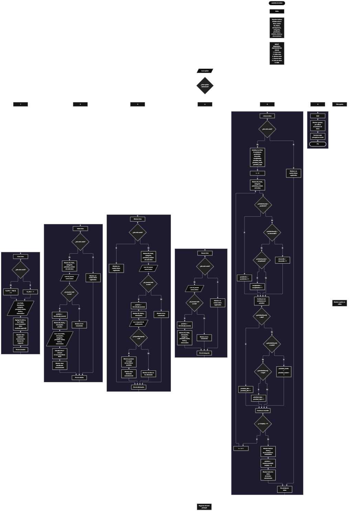

Este proyecto, llamado <b>anotador de ideas</b>, fue desarrollado en <b>python</b> como un ejercicio práctico para fortalecer la lógica de programación mediante la creación de un sistema de gestión de ideas desde la consola. El programa cuenta con un menú principal de seis opciones que permite <b>crear, editar, eliminar, buscar y listar ideas registradas</b>, además de consultar estadísticas y visualizar una idea seleccionada aleatoriamente. Cada idea almacena información como el título, la descripción, la categoría, la prioridad, el estado, la fecha y las observaciones, utilizando ocho listas paralelas que mantienen relacionados los datos de cada registro durante la ejecución. Durante su desarrollo se aplicaron conceptos fundamentales de programación, como variables, listas, estructuras condicionales, ciclos repetitivos, métodos de listas, búsqueda mediante identificadores y generación de números aleatorios. Este proyecto permite poner en práctica los conocimientos adquiridos en python y sirve como base para desarrollar sistemas de gestión más avanzados utilizando otros lenguajes y tecnologías.

<h2 align="center">⚙️ Funcionamiento del menú principal</h2>

### ➕ Crear idea

La opción <b>1) crear idea</b> permite registrar una nueva idea en el sistema. Antes de solicitar los datos, el programa comprueba si la lista <b>ids</b> está vacía mediante la condición <b>len(ids) == 0</b>. Si no existen ideas registradas, asigna el identificador inicial <b>1</b> a la variable <b>id_idea</b>. En caso contrario, genera el siguiente identificador sumando uno al último elemento de la lista mediante la expresión <b>ids[-1] + 1</b>. Después, solicita el <b>título, descripción, categoría, prioridad, estado, fecha y observación</b> de la idea. Los datos se almacenan en sus respectivas listas mediante el método <b>append()</b>, manteniendo la misma posición para los campos de cada registro. Finalmente, muestra el mensaje <b>"idea registrada correctamente."</b> y presenta el identificador asignado. Los valores sugeridos para la prioridad son alta, media y baja, mientras que los estados sugeridos son pendiente, en desarrollo y completada. Sin embargo, el programa no comprueba que los valores introducidos coincidan con estas opciones.

### ✏️ Editar idea

La opción <b>2) editar idea</b> permite modificar la información de una idea registrada. Primero, el programa comprueba si existen registros mediante la condición <b>len(ids) == 0</b>. Si no hay ideas almacenadas, muestra el mensaje <b>"no existen ideas registradas."</b>. En caso contrario, presenta una lista con el identificador, el título, la categoría, la prioridad y el estado de cada idea. Después, solicita el identificador de la idea que se desea editar mediante la variable <b>id_buscar</b> y comprueba si ese valor se encuentra en la lista <b>ids</b>. Si existe, utiliza el método <b>index()</b> para obtener su posición y muestra el identificador, el título y la descripción actuales. A continuación, solicita el nuevo título, la nueva descripción, la nueva categoría, la nueva prioridad, el nuevo estado, la nueva fecha y la nueva observación, actualizando directamente los valores de las listas correspondientes. Finalmente, presenta el mensaje <b>"idea actualizada correctamente."</b>. Si el identificador no existe, muestra el mensaje <b>"id no encontrada."</b>. El programa no valida el formato de los nuevos datos, por lo que los valores introducidos se almacenan directamente.

### 🗑️ Eliminar idea

La opción <b>3) eliminar idea</b> permite eliminar una idea registrada mediante su identificador. Antes de iniciar la operación, el programa comprueba si existen ideas almacenadas. Si la lista <b>ids</b> está vacía, muestra el mensaje <b>"no existen ideas registradas."</b>. Si hay registros disponibles, presenta una lista con el identificador, el título, la categoría, la prioridad y el estado de cada idea. Después, solicita el identificador de la idea que se desea eliminar y comprueba si se encuentra en la lista <b>ids</b>. Si existe, utiliza el método <b>index()</b> para localizar su posición y muestra el identificador, el título y la descripción del registro seleccionado. A continuación, solicita confirmación mediante la pregunta <b>"¿desea eliminar esta idea? (s/n):"</b>. Si la respuesta convertida a mayúsculas mediante <b>upper()</b> es igual a <b>"S"</b>, utiliza el método <b>pop()</b> para eliminar la posición correspondiente de las ocho listas: <b>ids, titulos, descripciones, categorias, prioridades, estados, fechas y observaciones</b>. Finalmente, muestra el mensaje <b>"idea eliminada correctamente."</b>. Si la respuesta es diferente de <b>"S"</b>, presenta el mensaje <b>"la idea no fue eliminada."</b>. Si el identificador no existe, muestra el mensaje <b>"id no encontrada."</b>.

### 🔎 Buscar idea

La opción <b>4) buscar idea</b> permite localizar una idea mediante su identificador. Primero, el programa comprueba si existen registros en la lista <b>ids</b>. Si no hay ideas almacenadas, muestra el mensaje <b>"no existen ideas registradas."</b>. En caso contrario, solicita el identificador mediante la variable <b>id_buscar</b> y comprueba si está presente en la lista <b>ids</b>. Cuando encuentra una coincidencia, utiliza el método <b>index()</b> para obtener la posición del registro y muestra todos sus datos: <b>identificador, título, descripción, categoría, prioridad, estado, fecha y observación</b>. Si el identificador no se encuentra en la lista, presenta el mensaje <b>"id no encontrada."</b>. Esta función permite consultar la información completa de una idea específica sin necesidad de recorrer manualmente todos sus campos. La búsqueda se realiza por identificador y no por título o categoría.

### 📋 Lista de datos

La opción <b>5) lista de datos</b> permite visualizar las ideas registradas, consultar estadísticas y obtener una idea seleccionada aleatoriamente. Primero, el programa comprueba si existen registros. Si no hay ideas almacenadas, muestra el mensaje <b>"no existen ideas registradas."</b>. Si hay registros disponibles, inicializa seis contadores: <b>pendientes, desarrollo, completadas, prioridad_alta, prioridad_media y prioridad_baja</b>. Después, utiliza un ciclo <b>for</b> para recorrer las listas y mostrar el identificador, el título, la categoría, la prioridad y el estado de cada idea. Durante el recorrido, compara los estados y las prioridades mediante el método <b>lower()</b>, que convierte el texto a minúsculas para realizar las comparaciones sin distinguir entre mayúsculas y minúsculas. Los estados contabilizados son <b>"pendiente", "en desarrollo" y "completada"</b>, mientras que las prioridades contabilizadas son <b>"alta", "media" y "baja"</b>. Al finalizar el recorrido, presenta la cantidad total de ideas y los resultados de los seis contadores. Finalmente, utiliza la función <b>random.randint(0, len(ids) - 1)</b> para seleccionar una posición aleatoria y muestra todos los datos de la idea correspondiente. Esta opción combina el listado de registros, el cálculo de estadísticas y la selección aleatoria de una idea.

### 🚪 Salir del menú principal

La opción <b>6) salir</b> permite finalizar la ejecución del programa. Cuando el usuario selecciona esta opción, el sistema muestra el mensaje <b>"gracias por utilizar el anotador de ideas."</b> y ejecuta la instrucción <b>break</b>, que interrumpe el ciclo principal <b>while True</b>. De esta manera, el menú deja de repetirse y el programa termina su ejecución. Si el usuario introduce un valor diferente de las opciones definidas, el bloque <b>else</b> muestra el mensaje <b>"opción no válida."</b> y el ciclo continúa, permitiendo seleccionar otra opción.

<h2 align="center">🧠 Temas aplicados en el proyecto</h2>

### 📦 Variables

En este proyecto se utilizan variables para controlar la opción seleccionada en el menú, generar identificadores, almacenar temporalmente los datos introducidos, localizar ideas registradas, controlar las estadísticas y seleccionar una idea aleatoria. Cada variable cumple una función específica dentro de las operaciones de gestión de ideas.

🔢 **Opcion:** Almacena la opción seleccionada por el usuario en el menú principal.

🆔 **Id_idea:** Almacena el identificador que se asignará a una nueva idea.

🔎 **Id_buscar:** Almacena el identificador introducido por el usuario para buscar, editar o eliminar una idea.

📍 **Posicion:** Almacena el índice de la idea localizada dentro de las listas paralelas.

📝 **Titulo:** Almacena temporalmente el título de la idea que se está registrando.

📄 **Descripcion:** Almacena temporalmente la descripción de la idea.

🗂️ **Categoria:** Almacena la categoría asignada a la idea.

⚡ **Prioridad:** Almacena el nivel de prioridad de la idea.

🔄 **Estado:** Almacena el estado actual de la idea.

📅 **Fecha:** Almacena la fecha introducida para la idea.

💬 **Observacion:** Almacena las observaciones adicionales de la idea.

📊 **Pendientes, Desarrollo y Completadas:** Son contadores utilizados para calcular la cantidad de ideas según su estado.

🎯 **Prioridad_alta, Prioridad_media y Prioridad_baja:** Son contadores utilizados para calcular la cantidad de ideas según su prioridad.

🔁 **I:** Funciona como contador del ciclo <b>for</b> y permite recorrer las posiciones de las listas durante el listado y el cálculo de estadísticas.

### 🗃️ Listas

En este proyecto se utilizan ocho listas paralelas para almacenar la información de las ideas. Todas las listas mantienen la misma organización por índices, de manera que los datos ubicados en una misma posición corresponden a una misma idea. Por ejemplo, el identificador de la posición <b>0</b> se encuentra en <b>ids[0]</b>, mientras que el título, la descripción, la categoría, la prioridad, el estado, la fecha y la observación de esa idea se encuentran en las posiciones equivalentes de sus respectivas listas. Esta estructura permite registrar, consultar, modificar y eliminar los datos de cada idea manteniendo la relación entre sus campos.

🆔 **Ids:** Almacena los identificadores de las ideas registradas.

📝 **Titulos:** Almacena los títulos de las ideas.

📄 **Descripciones:** Almacena las descripciones de las ideas.

🗂️ **Categorias:** Almacena las categorías asignadas a las ideas.

⚡ **Prioridades:** Almacena las prioridades de las ideas.

🔄 **Estados:** Almacena los estados de las ideas.

📅 **Fechas:** Almacena las fechas registradas para las ideas.

💬 **Observaciones:** Almacena las observaciones adicionales de las ideas.

### 🔀 Estructuras condicionales

En este proyecto se utilizan las estructuras <b>if, elif y else</b> para controlar las opciones del menú, comprobar si existen ideas registradas, determinar si un identificador se encuentra en la lista <b>ids</b>, decidir si se actualizan o eliminan los datos de una idea y contabilizar los estados y las prioridades. Estas condiciones permiten que el programa ejecute diferentes instrucciones según los datos almacenados y las decisiones del usuario. También se utilizan para mostrar mensajes cuando una idea no existe, cuando no hay registros disponibles o cuando la opción introducida no coincide con ninguna de las opciones del menú.

### 🔄 Estructuras repetitivas

En este proyecto se utilizan las estructuras repetitivas <b>while</b> y <b>for</b>. El ciclo <b>while True</b> mantiene activo el menú principal para que el usuario pueda realizar varias operaciones hasta seleccionar la opción de salida. Por otro lado, los ciclos <b>for</b> permiten recorrer las listas mediante la expresión <b>range(len(ids))</b> para mostrar los registros disponibles y calcular las estadísticas correspondientes. Estas estructuras facilitan la administración de múltiples ideas sin tener que escribir instrucciones individuales para cada registro.

### 🎯 Estructuras de selección

El programa utiliza una estructura de selección mediante las instrucciones <b>if, elif y else</b> para determinar qué operación debe ejecutarse según el valor de la variable <b>opcion</b>. Cada condición representa una de las seis opciones del menú principal: <b>crear idea, editar idea, eliminar idea, buscar idea, lista de datos y salir</b>. Cuando el valor introducido no coincide con ninguna de las opciones disponibles, el bloque <b>else</b> muestra el mensaje <b>"opción no válida."</b>. Esta organización permite distribuir las funcionalidades del programa en bloques de instrucciones independientes.

### 🧰 Métodos de listas

En este proyecto se utilizan los métodos <b>append(), index() y pop()</b> para administrar los registros almacenados. El método <b>append()</b> agrega los datos de una nueva idea al final de las listas correspondientes; <b>index()</b> permite obtener la posición de un identificador existente dentro de la lista <b>ids</b>; y <b>pop()</b> elimina el elemento ubicado en una posición determinada. Estos métodos permiten realizar las operaciones de registro, búsqueda, edición y eliminación mediante las listas paralelas.

### 🔢 Generación de identificadores

El programa utiliza la lista <b>ids</b> para generar los identificadores de las nuevas ideas. Cuando la lista está vacía, asigna el valor <b>1</b>. Cuando existen registros, toma el último identificador almacenado mediante <b>ids[-1]</b> y le suma uno. Esta operación permite asignar identificadores consecutivos según el orden de los registros existentes. Sin embargo, el programa no utiliza un contador independiente para conservar el último identificador generado. Por ello, si se elimina la idea que contiene el identificador más alto, el siguiente registro puede reutilizar ese identificador.

### 🔍 Búsqueda mediante identificadores

La búsqueda de ideas se realiza mediante el identificador almacenado en la lista <b>ids</b>. El programa solicita el identificador al usuario y comprueba si se encuentra en la lista mediante la condición <b>id_buscar in ids</b>. Si existe, utiliza <b>ids.index(id_buscar)</b> para localizar la posición correspondiente. A partir de ese índice, accede a los elementos de las otras siete listas para consultar o modificar la información relacionada. Este procedimiento también se utiliza durante la eliminación, lo que permite identificar el registro que se desea administrar sin buscar individualmente cada uno de sus campos.

### 📊 Contadores y estadísticas

El programa utiliza seis variables contadoras para obtener estadísticas sobre las ideas registradas. Los contadores <b>pendientes, desarrollo y completadas</b> permiten conocer cuántas ideas se encuentran en cada uno de los tres estados reconocidos. Por su parte, <b>prioridad_alta, prioridad_media y prioridad_baja</b> permiten contabilizar las ideas según los tres niveles de prioridad establecidos en las comparaciones. Los contadores se inicializan en cero cada vez que se selecciona la opción de listado y se incrementan durante el recorrido de las listas. Al finalizar, se muestran los resultados junto con el total de ideas registradas. Las estadísticas solo reconocen los valores que coinciden con los textos definidos en el código.

### 🎲 Selección aleatoria

El programa importa el módulo <b>random</b> para seleccionar aleatoriamente una de las ideas registradas. Después de mostrar el listado y las estadísticas, utiliza la función <b>random.randint(0, len(ids) - 1)</b> para generar una posición comprendida entre el primer índice y el último índice válido de la lista. La posición obtenida se almacena en la variable <b>posicion</b> y se utiliza para mostrar el identificador, el título, la descripción, la categoría, la prioridad, el estado, la fecha y la observación de la idea seleccionada. Esta funcionalidad se ejecuta únicamente cuando existen ideas registradas, debido a la comprobación inicial de la lista.

<h2 align="center">¿Cómo se implementaron las operaciones crud en el proyecto?</h2>

Las operaciones <b>crud</b> se implementaron mediante las opciones del menú principal para administrar las ideas registradas. La operación <b>crear</b> corresponde a <b>crear idea</b>, donde se solicitan los datos y se agregan a las ocho listas mediante el método <b>append()</b>. La operación <b>leer</b> se realiza mediante <b>buscar idea</b> y <b>lista de datos</b>, que permiten consultar los datos completos de un registro, visualizar los registros resumidos y obtener estadísticas. La operación <b>actualizar</b> corresponde a <b>editar idea</b>, donde se localiza la posición del registro y se sustituyen sus datos por los nuevos valores introducidos. Finalmente, la operación <b>eliminar</b> se realiza mediante <b>eliminar idea</b>, que solicita confirmación y utiliza <b>pop()</b> para eliminar el registro de cada lista. Estas operaciones utilizan variables, listas, condicionales y ciclos para gestionar la información almacenada temporalmente durante la ejecución del programa.

<h2 align="center">Diagrama de flujo del proyecto</h2>

<h2 align="center">🛡️ Validaciones del programa</h2>

### 📭 No existen ideas registradas

Esta comprobación se utiliza en las opciones de <b>editar idea, eliminar idea, buscar idea y lista de datos</b>. El programa verifica si la lista <b>ids</b> está vacía mediante la condición <b>len(ids) == 0</b>. Si no existen ideas registradas, muestra el mensaje <b>"no existen ideas registradas."</b> y evita continuar con la operación seleccionada. Esta comprobación también impide que la opción de listado intente seleccionar una idea aleatoria cuando no existen registros.

### ❌ Identificador no encontrado

Esta comprobación se utiliza en las operaciones de <b>editar idea, eliminar idea y buscar idea</b>. El programa verifica si el identificador introducido por el usuario se encuentra en la lista <b>ids</b> mediante la condición <b>id_buscar in ids</b>. Si el identificador existe, obtiene la posición del registro mediante el método <b>index()</b> y continúa con la operación correspondiente. Si no existe, muestra el mensaje <b>"id no encontrada."</b>. Esta comprobación permite evitar que el programa intente consultar, actualizar o eliminar una idea mediante un identificador que no está registrado.

### ⚠️ Confirmación de eliminación

Esta comprobación se utiliza durante la eliminación de una idea. Después de mostrar los datos principales del registro seleccionado, el programa solicita una respuesta mediante la pregunta <b>"¿desea eliminar esta idea? (s/n):"</b>. La respuesta se convierte a mayúsculas mediante el método <b>upper()</b> y se compara con el valor <b>"S"</b>. Si coincide, se elimina el registro de las ocho listas. Si la respuesta es cualquier otro valor, el programa muestra el mensaje <b>"la idea no fue eliminada."</b>. Aunque el mensaje sugiere responder sí o no, el código no comprueba que la entrada sea exclusivamente una de esas dos opciones.

### ⚠️ Opción inválida

El menú principal incluye una estructura condicional que evalúa las opciones introducidas por el usuario. Si el valor no coincide con ninguna de las seis opciones disponibles, el bloque <b>else</b> muestra el mensaje <b>"opción no válida."</b>. Después, el ciclo <b>while True</b> continúa y vuelve a presentar el menú principal. Esta comprobación controla las opciones del menú, pero no valida los datos introducidos en los campos de cada idea.

### ⚠️ Entrada de identificadores

En las operaciones de <b>editar idea, eliminar idea y buscar idea</b>, el programa utiliza <b>int(input(...))</b> para convertir el identificador introducido por el usuario en un número entero. Sin embargo, no incluye una comprobación previa para determinar si la entrada contiene un número válido. Si el usuario introduce texto u otro valor que no pueda convertirse a entero, el programa puede generar un error y detener la ejecución. Esta limitación corresponde al comportamiento actual del código.

### ⚠️ Prioridades y estados

Durante el registro y la edición, el programa solicita una prioridad y un estado, indicando los valores esperados en los mensajes de entrada. No obstante, no utiliza condiciones para impedir que se introduzcan valores diferentes. Las estadísticas únicamente contabilizan las prioridades <b>"alta", "media" y "baja"</b> y los estados <b>"pendiente", "en desarrollo" y "completada"</b>, comparándolos después de convertirlos a minúsculas mediante <b>lower()</b>. Por esta razón, los valores distintos de los esperados se almacenan, pero no se incluyen en los contadores correspondientes.

### 💾 Almacenamiento temporal de los datos

El programa utiliza listas de Python para mantener la información de las ideas durante la ejecución. No implementa archivos, bases de datos ni otro mecanismo de almacenamiento permanente. Por ello, los registros se mantienen disponibles mientras el programa continúa ejecutándose, pero se pierden cuando finaliza la ejecución. Esta característica corresponde a la implementación actual del proyecto y permite trabajar con estructuras de datos en memoria.

<h2 align="center">🎯 Objetivo del proyecto</h2>

El objetivo principal de este proyecto es fortalecer la <b>lógica de programación</b> mediante el desarrollo de un sistema de gestión de ideas en <b>python</b>. A través de su construcción se busca aplicar los conocimientos adquiridos sobre variables, listas, estructuras condicionales, ciclos repetitivos, métodos de listas, búsqueda mediante identificadores, contadores y generación de números aleatorios, integrándolos para resolver un problema de manera organizada. Además, el proyecto permite comprender cómo registrar, consultar, modificar y eliminar información en una aplicación de consola, así como calcular estadísticas y seleccionar registros aleatoriamente. De esta manera, constituye una base para desarrollar sistemas de gestión más completos y ampliar los conocimientos de programación utilizando otros lenguajes y tecnologías.

